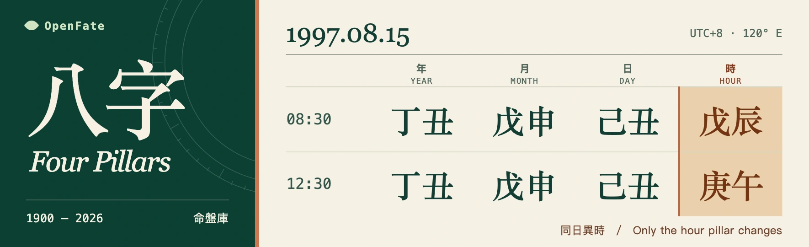
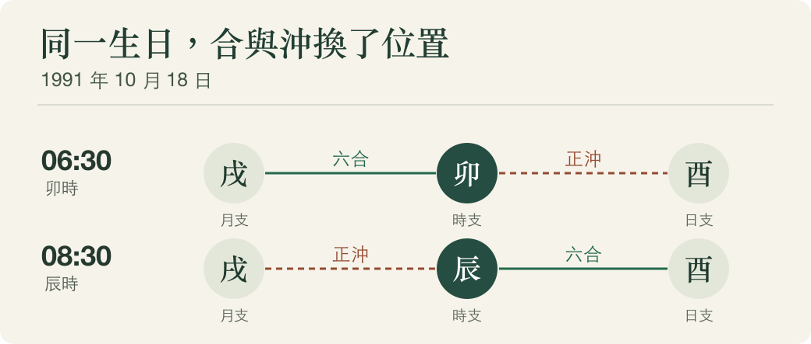

# OpenFate Bazi Engine

**1.11 million chart samples, 14.46 million reading chapters and over 100 million annual projections.**

[**Browse the 13 chapters**](https://openfate-ai.github.io/bazi-engine/library/) · [28 classical pattern entries](https://openfate-ai.github.io/bazi-engine/library/atlas/) · [Search by chart pattern](https://openfate-ai.github.io/bazi-engine/library/search/) · [Compare two birth times](https://openfate-ai.github.io/bazi-engine/compare/) · [Download the corpus](https://github.com/openfate-ai/bazi-engine/releases/tag/corpus-v2.1.0) · [English field guide](learn/en.md) · [繁體中文](README.md)

<div>
<a href="https://openfate-ai.github.io/bazi-engine/compare/"><picture>
  <source media="(max-width: 600px)" srcset="learn/cover-mobile.webp">
  
</picture></a>
</div>

On August 15, 1997, changing the birth time from 08:30 to 12:30 changes the hour pillar and the relationship chapter. Open the comparison to see both readings and the rule behind each one. The 1900–2026 corpus covers **402,736 distinct Four Pillars combinations** and includes 13 Traditional Chinese life chapters per sample.

The classical atlas evaluates 12 month frames and 16 special structures across the same grid. Each entry gives its rule, a matching chart, a near miss, and separate counts for birth inputs and distinct four-pillar combinations. You can combine a frame with a natal interaction or a Da Yun timing condition. [Browse the atlas](https://openfate-ai.github.io/bazi-engine/library/atlas/) · [Definitions and reproducibility](corpus/ATLAS.md)

The [pattern index](corpus/PATTERNS.md) covers 556,164 representative birth times. At 75,159 of them, one pillar participates in both a six-combination and a clash. In 391,676 paired samples the two civil onset dates differ by at least 1,096 days. The browser and the dependency-free Node CLI use the same downloadable index. [Search the corpus](https://openfate-ai.github.io/bazi-engine/library/search/)

The [online library](https://openfate-ai.github.io/bazi-engine/library/) opens all 13 chapters for any corpus sample. Select a second time to compare individual passages and their chart evidence. The [Da Yun exercise](https://openfate-ai.github.io/bazi-engine/library/practice.html) uses three charts with answers drawn from the same runtime. The chapters and exercises are in Traditional Chinese.

| What would you like to do? | Start here |
| --- | --- |
| Build a charting app | [Run the JavaScript example below](#reproduce-the-example). The SDK calculates charts locally. |
| Build a searchable reading library | [Download one birth year](#download-one-year) and join the records by birth ID. |
| Connect an AI client | [Install the MCP server](https://github.com/openfate-ai/openfate-mcp#install). Its tools include chart calculation and reverse lookup. |
| Learn how the interpretation works | [Compare two charts in the browser](https://openfate-ai.github.io/bazi-engine/compare/) and follow each rule back to its source. |

To run the comparison page locally, clone this repository, run `npm ci` and `npm run build:pages` in its root, then run `python3 -m http.server 8000 --bind 127.0.0.1 --directory docs`. Open `http://127.0.0.1:8000/compare/` in your browser.

## Reproduce the example

```sh
npm install @openfate/bazi-engine@^2.1.0
```

```js
const { calculateBaziChart, readBaziRelationship } = require('@openfate/bazi-engine');

for (const hour of [8, 12]) {
  const chart = calculateBaziChart({
    year: 1997, month: 8, day: 15, hour, minute: 30, gender: 'female',
    timezone: 8, dstOffset: 0, longitude: 120,
    dayBoundaryMode: 'ZI_HOUR_23', daYunTimingVersion: 'DAYUN_SECOND_V2'
  });
  const reading = readBaziRelationship(chart);
  console.log(reading.ruleId, reading.title);
  console.log(reading.evidence);
}
```

At 08:30 the hour pillar is 戊辰. The day and hour branches form 丑辰相破, so the chapter asks where an agreed handoff broke down. At 12:30 the hour pillar is 庚午. The branches now form 丑午相害, and the chapter asks which decision the other person wanted to make themselves. Each evidence entry includes a JSON Pointer and its value in the supplied chart. The scenarios illustrate the editorial rule. [Rule source](src/readings/relationship.ts) · [Regression cases](tests/relationship-reading.test.ts)

## Learn to read a chart

The field guide starts with hidden stems and uses diagrams to show how the same hour branch can combine with the month and clash with the day. Work through seven lessons, compare the classical sources, then try three unseen charts. [English field guide](learn/en.md) · [Classical sources](learn/sources.md) · [Practice charts](learn/practice.md)

### One set of pillars, two different luck cycles

For October 18, 1991 at 08:30, the archive gives 辛未、戊戌、辛酉、壬辰 for both sex inputs used by the traditional direction rule. The female input moves forward from the birth instant to the Start of Winter (立冬). Its first cycle is 己亥, starting October 6, 1998. The male input looks back to Cold Dew (寒露). Its first cycle is 丁酉, starting November 14, 1994. Keep the birth ID when joining records so you can tell the timelines apart. [Worked timings](learn/luck-direction.md) · [2026 annual comparison](learn/annual-reading.md)

[](learn/interactions.md)

The source index identifies the relevant scans or chapters in three classics. *Zi Ping Zhen Quan* provides examples for reading roots and competing branch relations. *Qiong Tong Bao Jian* includes two cases that differ only in their hour pillar. *San Ming Tong Hui* supplies examples for Ten Gods and the direction of luck cycles. The course places those readings beside modern worked charts. [Editions and page references](learn/sources.md) · [Classical and modern cases side by side](learn/schools.md)

## Offline corpus

The frozen v2.1 corpus covers January 1, 1900 through November 22, 2026. Its 1,112,328 representative birth inputs contain **14,460,264 life chapters** in total, with five scenario questions per chapter. Inputs with the same four pillars can share natal reading text. Each input with a resolved luck-cycle onset has 90 midyear observations, for a total of **100,092,240 annual projections**. [Counts and checksums by year](https://github.com/openfate-ai/bazi-engine/releases/download/corpus-v2.1.0/edition-manifest.json)

Download the offline reader and a single year to explore a chart, or download the compressed volumes and reproduce the edition. The live SDK provides one relationship chapter. [Dataset guide](corpus/README.md) · [Offline reader](https://github.com/openfate-ai/bazi-engine/releases/download/corpus-v2.1.0/reader.html) · [Year files](https://github.com/openfate-ai/bazi-engine/releases/tag/corpus-v2.1.0)

### Download one year

The offline reader (242 KB) and the 1991 chart file (4.57 MB) are enough to open the example. In the reader, load the compressed year file and select October 18, 08:30, female. All sizes here use decimal units.

```sh
gh release download corpus-v2.1.0 --repo openfate-ai/bazi-engine \
  --pattern reader.html --pattern 1991.jsonl.gz --dir openfate-1991
```

For machine-readable full text, the same year's [life chapters](https://github.com/openfate-ai/bazi-engine/releases/download/corpus-v2.1.0/1991.book.jsonl.zst) are 4.80 MB and its [annual observations](https://github.com/openfate-ai/bazi-engine/releases/download/corpus-v2.1.0/1991.yearbook.jsonl.zst) are 8.87 MB. The all-year archives are [590 MB for core chart data](https://github.com/openfate-ai/bazi-engine/releases/download/corpus-v2.1.0/OpenFate-Bazi-Corpus-1900-2026-11-22-v2.1.0-core.tar), [616 MB for books](https://github.com/openfate-ai/bazi-engine/releases/download/corpus-v2.1.0/OpenFate-Bazi-Corpus-1900-2026-11-22-v2.1.0-books.tar) and [1.12 GB for yearbooks](https://github.com/openfate-ai/bazi-engine/releases/download/corpus-v2.1.0/OpenFate-Bazi-Corpus-1900-2026-11-22-v2.1.0-yearbooks.tar).

Run this from the folder containing `1991.jsonl.gz` with Python 3. You can join the result to the book or yearbook JSON Lines record using the same ID.

```python
import gzip
import json

birth_id = "1991-10-18T08:30:00+08:00/female"
with gzip.open("1991.jsonl.gz", "rt", encoding="utf-8") as rows:
    chart = next(row for row in map(json.loads, rows) if row["id"] == birth_id)

print(chart["fourPillars"])         # 辛未 戊戌 辛酉 壬辰
print(chart["daYun"]["startDate"])  # 1998-10-06 11:30:00
print(chart["readings"]["work"]["evidence"])
```

### What the release verifies

| Measure | Result |
| --- | --- |
| Text length | Across 308 sampled records, the 13 life chapters had a median of 10,834 Han characters per record, with a range of 10,098 to 11,377. [Sample IDs and counts](https://github.com/openfate-ai/bazi-engine/releases/download/corpus-v2.1.0/edition-manifest.json) |
| Calendar conversion | On all 46,347 dates, the 12:30 sample matched the reference lunar year, month, day and leap-month flag. [Calendar audit](https://github.com/openfate-ai/bazi-engine/releases/download/corpus-v2.1.0/calendar-reference.json) |
| Timing boundaries | For 192 inputs, the birth instant and the solar-time chart disagree at a term boundary. The edition keeps their natal chapters and leaves the annual list empty. [A 1932 example](learn/solar-term.md) |
| Hour-sensitive text | Among 132 adjacent-hour pairs in the published comparison, 74 pairs selected different career opening advice in edition 2.1.0. [Comparison data](https://github.com/openfate-ai/bazi-engine/releases/download/corpus-v2.1.0/opening-comparison.json) |

The corpus freezes its chart dependency at SDK 2.0.0. Use the tagged edition to reproduce the published readings. SDK 2.2.0 includes the pinned corpus runtime in `dist/corpus.mjs` and also offers a live relationship chapter with its own rules version. Its [selection rules](src/readings/relationship.ts), the [published chapter openings](corpus/chapter-openings.mjs) and the [annual generator](corpus/yearbook.mjs) can each be inspected separately.

## Lunar Calendar Input

```typescript
const chart = calculateBaziChart({
  year: 1998, month: 10, day: 25,  // Lunar date
  calendarType: 'lunar',
  hour: 12, gender: 'male', longitude: 116.39, timezone: 8,
});
// Automatically converts to Solar 1998-12-13 before calculating
```

## Configuration

```typescript
calculateBaziChart({
  // ...
  enableTrueSolarTime: true,        // default: true (requires longitude)
  dayBoundaryMode: 'MIDNIGHT_00',   // 'MIDNIGHT_00' (default) or 'ZI_HOUR_23' (traditional)
  calendarType: 'solar',            // 'solar' (default) or 'lunar'
  timezoneId: 'Asia/Shanghai',      // Preferred for historical civil-time rules
  // Or provide the complete explicit pair: timezone: 8, dstOffset: 1
  daYunTimingVersion: 'DAYUN_SECOND_V2', // opt in; legacy timing remains the default
});
```

When `timezoneId` is present and either `timezone` or `dstOffset` is omitted, the
IANA zone determines the historical standard offset and DST adjustment. An explicit
numeric `timezone` + `dstOffset` pair remains authoritative. The resolved DST value is
returned in `metadata.dstOffset` when an hour is supplied, including when True Solar
Time is disabled.

### Versioned Da Yun onset

`LEGACY_SHICHEN_V1` remains the default, so upgrading does not silently move existing
cycle dates. Set `daYunTimingVersion: 'DAYUN_SECOND_V2'` to measure the physical interval
between the birth instant and the applicable Jie boundary, then apply the declared
three-days-per-year conversion at second resolution.

```typescript
const chart = calculateBaziChart({
  year: 2001, month: 7, day: 2, hour: 3, minute: 14,
  gender: 'male', longitude: 112.6986, timezoneId: 'Asia/Shanghai',
  dayBoundaryMode: 'ZI_HOUR_23',
  daYunTimingVersion: 'DAYUN_SECOND_V2',
});

console.log(chart.daYun.startDate); // 2010-03-23 19:14:00
console.log(chart.daYun.timing);    // birth/Jie UTC instants, interval, policy, rounding
```

V2 rejects ambiguous or nonexistent IANA wall times instead of choosing one silently.
If the birth time, timezone, or Jie lookup is unavailable, the existing legacy scalar
fields remain for compatibility and `daYun.timing` returns `status: 'UNAVAILABLE'`, a
reason, and `fallbackVersion: 'LEGACY_SHICHEN_V1'`. Callers that require V2 must check
the receipt before presenting an exact onset. IANA resolution is explicitly labeled
`HOST_INTL`; pass a complete numeric `timezone` + `dstOffset` pair when a frozen offset
is required.

## API Reference

### `readBaziRelationship(chart): RelationshipReading`

Returns the selected chapter's title, body, practice, rule ID, rules version and evidence. Read `otherRelations` for coexisting day–hour relations. When the hour is missing, `status` is `unknown-hour` and the hour pillar stays null.


### `calculateBaziChart(input: BaziInput): BaziChart`
Main entry point. Returns a `BaziChart` with:
- `pillars` — Four Pillars (year, month, day, hour)
- `dayMaster` — Day Master stem with element, polarity, pinyin
- `daYun` — 9 Major Luck Cycles with start year/age and versioned timing provenance
- `interactions` — Raw branch relationships (8 types), preserving every pillar occurrence
- `solarTimeInfo` — True Solar Time details (or null if disabled)
- `calendar` — Civil solar input, calculation solar time, converted lunar date, and zodiac
- `metadata` — Applied True Solar Time, timezone, DST, and day-boundary policy

Each pillar preserves the simple `stem`, `branch`, and `element` fields and also includes Ten Gods, hidden stems, Na Yin, Xun, void branches, and growth stage.

### `detectInteractions(natal, annualBranchOrContext?): BranchInteraction[]`

Detect raw relationships in natal branches, optionally adding an annual branch (太岁), a Da Yun branch, or both. The original annual-string argument remains supported. Omit `hour` or pass an empty string when the time is unknown; no hour is invented. Empty branch slots are omitted; invalid non-empty values throw `RangeError`.

```typescript
const relationships = detectInteractions(
  { year: '申', month: '寅', day: '申' },
  { dayunBranch: '申', annualBranch: '子' },
);
// Three distinct 寅申 clashes: year/month, month/day, month/dayun.
```

- Every distinct pair and full-group embedding is retained. Three 午 occurrences produce three self-punishment pairs; four produce six. They are separate structural occurrences, **not** independent penalties to sum.
- Types: `CLASH`, `COMBINATION_2`, `COMBINATION_HALF`, `TRINE`, `DIRECTIONAL`, `PUNISHMENT`, `DESTRUCTION`, `HARM`.
- `COMBINATION_HALF` uses the eight king-node pairs: 申子、子辰、寅午、午戌、亥卯、卯未、巳酉、酉丑. Endpoint-only pairs such as 申辰 are not half trines in this profile. Half relationships remain present when the full trine also exists; consumers must not count both as independent energy effects.
- The existing punishment policy is preserved: 寅巳申 and 丑戌未 require all three branches; 子卯 and the 辰、午、酉、亥 self-punishments use distinct pairs. This release does not add partial three-punishment school variants.
- `branches[i]` always belongs to `pillars[i]`, ordered `year`, `month`, `day`, `hour`, `dayun`, `annual`. `id` is the type followed by those occurrence identities, for example `CLASH:year:申|month:寅`. Output order is deterministic: the type order listed above, then occurrence role order. Object property insertion order has no effect.
- Combinations carry `transformationStatus: 'NOT_EVALUATED'`; other types carry `'NOT_APPLICABLE'`. Branch presence alone cannot establish transformation or resolve a competing clash. No weight, score, energy delta, strength, or pattern verdict is returned.
- `targetElement` is only the affinity of half/full trines and directional groups, **not** proven transformation. Half trines and 六合 have no `resultElement`. Full trines/directional groups retain `resultElement` as a legacy affinity alias; it is not confirmation of transformation.

Migration: review consumers that assumed one result per branch-name pair, fixed array order, exhaustive switches on seven types, or automatic 六合 transformation. Store by stable `id`, not just branch names. Keep raw relationships separate from any settled/scored chart model; adding more raw occurrences must not automatically multiply its weights. This package's branch detector does not decide whether a chart forms a classical pattern or predict life outcomes.

**Version 2 migration:** version 2 changes the public contract: `id` and
`transformationStatus` are required, `pillars` uses a role union, `InteractionType`
has a new member, and 六合 no longer exposes `resultElement`. It is not a drop-in
upgrade from version 1. Review interaction consumers before adopting version 2,
store relationships by stable `id`, and keep raw occurrences separate from any
settled or scored chart model.

### `generatePillarsFromSolar(...): PillarResult`
Low-level pillar generator — use when you've already handled time correction yourself.

## Contributing

From a checkout, run `npm ci`, `npm test`, `npm run build`, and `npm run build:pages`. For a reading rule change, add a chart that should select the new rule and one that should retain its existing advice. Update the reading rules version. For calendar discrepancies, include the civil input, timezone, longitude, day boundary and Da Yun timing version. [Tests](tests) · [Issues](https://github.com/openfate-ai/bazi-engine/issues)

## License

The engine is distributed under MIT. The corpus data and its original readings use CC BY 4.0. [Code license](LICENSE) · [Dataset license and attribution](corpus/DATASET-LICENSE.md)
