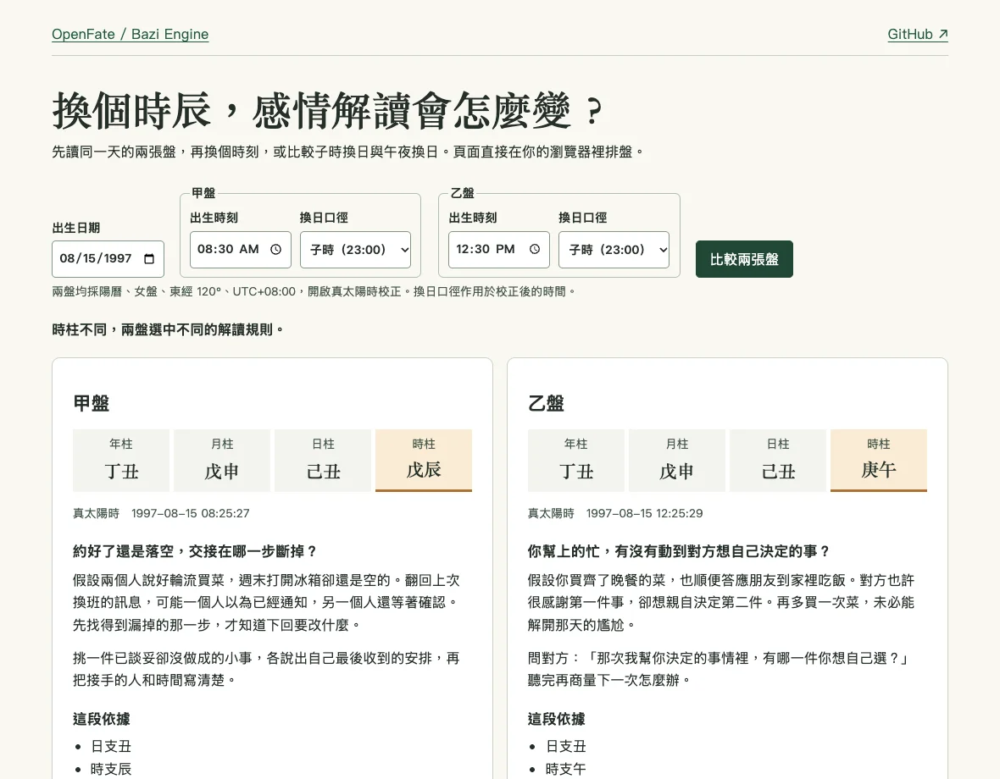
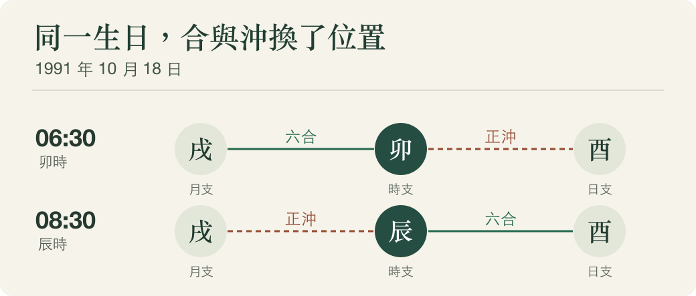

# OpenFate 八字引擎

**111 萬筆八字排盤樣本，1,446 萬章生活解讀，超過 1 億筆流年推演。**

從 1900 年排到 2026 年，命盤庫收錄 **402,736 種不同四柱**。每筆樣本附 13 章繁體中文解讀，涵蓋工作、感情與家庭等主題。想看解讀怎麼來？打開同一天 08:30 與 12:30 的兩張盤，看看換了哪個字，讓感情章問了另一個問題。點進規則原始碼，就能改完再排一次。

**[打開雙盤對照](https://openfate-ai.github.io/bazi-engine/compare/)** · [跟著命例學八字](learn/README.md) · [下載八字命盤庫](https://github.com/openfate-ai/bazi-engine/releases/tag/corpus-v2.1.0) · [English / API reference](README.en.md)

[](https://www.npmjs.com/package/@openfate/bazi-engine) [](https://github.com/openfate-ai/bazi-engine/actions/workflows/ci.yml)

## 從哪裡開始

| 你想做什麼 | 可以先做的第一件事 |
| --- | --- |
| 看自己的八字 | [線上排一張盤](https://openfate.ai/zh-hant/bazi-chart)。想先看範例，可直接打開下方的雙盤對照。 |
| 做排盤網站 | [安裝 JavaScript SDK](#sdk-start)，用一個出生輸入取得四柱，再用回傳的欄位畫出命盤。 |
| 做命理 AI 或研究資料 | [先下載 1991 年](#download-year)。用出生 ID 把盤面、成稿和逐年資料接起來，再挑要研究的章節。 |
| 在 Claude 或 Cursor 裡排盤 | [安裝 OpenFate MCP](https://github.com/openfate-ai/openfate-mcp#install)，把同一個引擎接進對話。 |
| 學會自己看一張盤 | [從合沖圖和原書命式開始](#classics)。看完把答案遮住，試讀下一張盤。 |

**想叫程式助理把示範跑在自己電腦上？** 可以直接貼這句：

> 請把 `https://github.com/openfate-ai/bazi-engine` 複製到新的資料夾，在專案根目錄執行 `npm ci` 和 `npm run build:pages`。用 `python3 -m http.server 8000 --bind 127.0.0.1 --directory docs` 啟動，再開啟 `http://127.0.0.1:8000/compare/`，並排顯示範例的兩張盤。

## 看一張盤怎麼變成一段解讀

1997 年 8 月 15 日，女命，東經 120°、UTC+8。兩張盤都採真太陽時、子初換日，年、月、日三柱都是 **丁丑、戊申、己丑**。換了出生時刻，日支「丑」遇到的時支就不同了。

| 出生時刻 | 時柱 | 日支與時支 | 感情章問的第一個問題 |
| --- | --- | --- | --- |
| 08:30 | 戊辰 | 丑、辰相破 | 約好了還是落空，交接在哪一步斷掉？ |
| 12:30 | 庚午 | 丑、午相害 | 你幫上的忙，有沒有動到對方想自己決定的事？ |

第一篇寫兩個人約好輪流買菜，到了週末，冰箱卻還是空的。第二篇裡，菜已經買好了，問題出在有人順便答應朋友來家裡吃飯。這些是編寫的生活情境。打開範例後，可以從每篇下方的「這段依據」查到日支、時支，以及引擎選用的關係。[互動範例](https://openfate-ai.github.io/bazi-engine/compare/) · [感情章規則](src/readings/relationship.ts)

[](https://openfate-ai.github.io/bazi-engine/compare/)

### 四柱相同，為什麼起運差了將近四年？

換一個例子。1991 年 10 月 18 日 08:30，兩筆資料的真太陽時都是 08:44:40，四柱都是 **辛未、戊戌、辛酉、壬辰**。這次只換排運所用的性別。從月柱戊戌出發，兩筆會往不同方向找節。

| 排運輸入 | 從出生時刻往哪邊找 | 第一運 | 起運日期（UTC+8） |
| --- | --- | --- | --- |
| 女 | 往後數到立冬 | 己亥 | 1998-10-06 |
| 男 | 往前數到寒露 | 丁酉 | 1994-11-14 |

打開兩筆資料的 2026 年 7 月 1 日，流年同為丙午。女盤走辛丑運，男盤走甲午運。如果只把四柱當資料索引，這兩段會被併成一筆。發行檔的 ID 保留出生時刻與排運性別，可以分開查。[起運推算過程](learn/luck-direction.md) · [逐年對照](learn/annual-reading.md)

<a id="classics"></a>

## 跟著命例學八字

| 你想弄懂的問題 | 從這裡開始 |
| --- | --- |
| 四個天干都沒有辛，為什麼這張甲日盤還讀得到正官？ | [在 1900 年元旦的盤上找藏干](learn/reading-pillars.md) |
| 同一個時支，怎麼可以一邊合、一邊沖？ | [看兩張關係圖，把每一條線接回它所在的柱](learn/interactions.md) |
| 《子平真詮》和《窮通寶鑑》看同一張盤，各自先問什麼？ | [對讀原書命式與現代命例](learn/schools.md) · [查卷次、篇名與影印頁](learn/sources.md) |
| 換一個時辰，職涯建議會具體改在哪裡？ | [讀卯時與辰時的完整職涯章](learn/career-readings.md) |
| 換一張沒見過的盤，我還看得出來嗎？ | [先做三題，再展開答案](learn/practice.md) |

[七堂入門課](learn/README.md) · [六對同日異時的完整試讀稿](learn/reader-pilot/readings.md) · [圖解與練習](learn/reader-pilot/lessons.md) · [讀者回饋與試讀方法](learn/reader-pilot/README.md)

### 從圖上的兩條線讀回原典

[](learn/interactions.md)

在右圖找到時支「辰」。往月支「戌」畫，是辰戌沖；往日支「酉」畫，是辰酉合。如果把圖收成一句「此盤有合」，就看不出這兩條線分別牽到誰。[完整圖解與練習](learn/interactions.md)

| 古籍 | 在這裡學什麼 |
| --- | --- |
| 《子平真詮》 | 讀〈論刑沖會合解法〉，再對照上圖。想追問月支所藏的字如何透出，接著讀〈論雜氣如何取用〉。[卷頁索引](learn/sources.md) |
| 《窮通寶鑑》 | 〈三秋辛金〉的兩個古例同年、月、日，只換時柱。把原書的「時、日、月、年」轉回常見欄序，再比對現代辰時盤的日支。[兩張原書命式](learn/schools.md) |
| 《三命通會》 | 從卷五「甲見辛為正官」回到 1900 年元旦的甲日盤。在明干找不到辛，還可以往哪一柱的藏干找？[看盤與答案](learn/reading-pillars.md) |

古籍索引保留採用的版本與出處。買菜、面試和談加薪等生活情境由 OpenFate 編寫，章節列出選用它們的盤面條件。[原典與編寫說明](learn/sources.md)

## 下載 1900–2026 八字命盤庫

1900 年 1 月 1 日至 2026 年 11 月 22 日，共 46,347 天。每天取 12 個代表時刻，各排女、男兩組，合計 **1,112,328 筆樣本**。整庫採固定 UTC+8、東經 120°、無夏令時間。[排盤規格](corpus/README.md)

逐筆加總，發行檔共收錄 **14,460,264 章生活解讀**，每章附 5 個情境問題。相同四柱可共用原局文字。起運可確定的樣本各收錄 90 筆年中觀察，合計 **100,092,240 筆流年推演**。各年度的筆數與檔案雜湊都可下載核對。[逐年統計清單](https://github.com/openfate-ai/bazi-engine/releases/download/corpus-v2.1.0/edition-manifest.json)

| 想做的事 | 要打開的檔案 |
| --- | --- |
| 先讀一張完整的盤 | [1991 年 10 月 18 日樣稿](corpus/examples/1991-10-18T08-30-female.md)，可以直接在 GitHub 閱讀。 |
| 離線查自己的出生年份 | 下載 [reader.html](https://github.com/openfate-ai/bazi-engine/releases/download/corpus-v2.1.0/reader.html) 和[所需年份的排盤檔](https://github.com/openfate-ai/bazi-engine/releases/tag/corpus-v2.1.0)，用瀏覽器開啟即可。 |
| 分析或重製整庫 | `core` 收排盤、標籤與技術解讀，`books` 收每筆 13 章生活解讀與 65 個情境問題，`yearbooks` 收起運可確定的逐年觀察。三類檔案以出生輸入 ID 對讀。[查詢指令與檔案校驗](corpus/README.md) |

發行版附外部曆表核對紀錄。1900 年使用紫金山天文台曆表，1901 年起使用香港天文台對照表，逐日比對中午的農曆日期與閏月。生活章節另外核對引用的盤面欄位。讀者對文字的評價收在試讀教材裡。[曆表核對紀錄](https://github.com/openfate-ai/bazi-engine/releases/download/corpus-v2.1.0/calendar-reference.json) · [成稿核對清單](https://github.com/openfate-ai/bazi-engine/releases/download/corpus-v2.1.0/edition-manifest.json)

<a id="download-year"></a>

### 先下載一年，大約 4.8 MB 就能離線讀盤

以 1991 年為例，用瀏覽器下載 [reader.html](https://github.com/openfate-ai/bazi-engine/releases/download/corpus-v2.1.0/reader.html)（242 KB）和 [1991.jsonl.gz](https://github.com/openfate-ai/bazi-engine/releases/download/corpus-v2.1.0/1991.jsonl.gz)（4.57 MB）。打開閱讀器，選「從年度檔查盤」，載入壓縮檔，輸入 **1991-10-18、08:30、女**。畫面應出現 **辛未、戊戌、辛酉、壬辰**。習慣用終端機的人可以一次取回這兩個檔案：

```sh
gh release download corpus-v2.1.0 --repo openfate-ai/bazi-engine \
  --pattern reader.html --pattern 1991.jsonl.gz --dir openfate-1991
```

如果要直接處理已寫好的文字，請再下載同年的 [生活章節](https://github.com/openfate-ai/bazi-engine/releases/download/corpus-v2.1.0/1991.book.jsonl.zst)（4.80 MB）或 [逐年記錄](https://github.com/openfate-ai/bazi-engine/releases/download/corpus-v2.1.0/1991.yearbook.jsonl.zst)（8.87 MB）。檔案以 JSON Lines 儲存，每行對應一組代表出生輸入。下列三個全庫封裝可解到同一目錄；表中大小均採十進位。

| 全庫下載 | 大小 | 解開後的主要內容 |
| --- | ---: | --- |
| [Core](https://github.com/openfate-ai/bazi-engine/releases/download/corpus-v2.1.0/OpenFate-Bazi-Corpus-1900-2026-11-22-v2.1.0-core.tar) | 590 MB | 排盤與標籤、13 段技術解讀、閱讀器、清單與查詢工具 |
| [Books](https://github.com/openfate-ai/bazi-engine/releases/download/corpus-v2.1.0/OpenFate-Bazi-Corpus-1900-2026-11-22-v2.1.0-books.tar) | 616 MB | 13 章生活解讀及每章採用的條件、情境與引用 |
| [Yearbooks](https://github.com/openfate-ai/bazi-engine/releases/download/corpus-v2.1.0/OpenFate-Bazi-Corpus-1900-2026-11-22-v2.1.0-yearbooks.tar) | 1.12 GB | 各步大運內的年中觀察、當年干支與盤面依據 |

### 開一筆 JSON，看文字怎麼接回命盤

下載單年排盤檔後，在放有 `1991.jsonl.gz` 的目錄，用 Python 3 標準函式庫就能查，不必先裝 SDK。

```python
import gzip
import json

birth_id = "1991-10-18T08:30:00+08:00/female"
with gzip.open("1991.jsonl.gz", "rt", encoding="utf-8") as rows:
    chart = next(row for row in map(json.loads, rows) if row["id"] == birth_id)

print(chart["fourPillars"])         # 辛未 戊戌 辛酉 壬辰
print(chart["daYun"]["startDate"])  # 1998-10-06 11:30:00
print(chart["readings"]["work"]["evidence"])
```

做命盤搜尋，可以先用 `fourPillars` 找相同四柱，再保留各筆的 `id` 比較大運。做檢索式問答，可以把生活正文與同 ID 的盤面放在一起，回答時一併顯示證據欄位。若拿來評估模型，先按四柱分組再切訓練集與測試集，避免相同原局文字同時落進兩邊。[查詢工具](corpus/lookup.py) · [欄位與重製指令](corpus/README.md)

### 一份解讀有多長？哪些數字能重查？

- **每筆 13 章，共 65 個情境問題。** 工作章可以一路讀到面試、職責與加薪。全庫逐筆累計有 72,301,320 筆章內情境，遇到相同盤面條件會共用文字。[讀一篇完整樣稿](corpus/examples/1991-10-18T08-30-female.md)
- **308 筆樣本的正文中位數為 10,834 個漢字。** 計算範圍是每筆的 13 章生活正文，樣本介於 10,098 至 11,377 字。清單保留了每一筆出生 ID 與字數，可以自行重算。[抽樣清單](https://github.com/openfate-ai/bazi-engine/releases/download/corpus-v2.1.0/edition-manifest.json) · [計數程式](corpus/audit-volume.mjs)
- **46,347 天逐日核對農曆，46,347 天相符。** 每天取 12:30 的固定樣本，比對農曆年、月、日與閏月。這項核對衡量曆法換算；生活建議另有命例試讀。[外部曆表核對](https://github.com/openfate-ai/bazi-engine/releases/download/corpus-v2.1.0/calendar-reference.json) · [讀者回饋與試讀方式](learn/reader-pilot/README.md)

全庫另有 192 筆落在交節邊界，保留原局和生活章節，逐年觀察留空。例如 1932 年立春那筆 08:30 女盤，民用出生時刻在引擎採用的交節瞬間後 40 秒，真太陽鐘面卻還在交節前。兩種基準取出的柱位有差異，資料裡留下判斷原因。[交節當日的三張盤](learn/solar-term.md)

<a id="sdk-start"></a>

## 用 JavaScript 重現首頁的兩張盤

```sh
npm install @openfate/bazi-engine@^2.1.0
```

```js
const { calculateBaziChart, readBaziRelationship } = require('@openfate/bazi-engine');

for (const hour of [8, 12]) {
  const chart = calculateBaziChart({
    year: 1997, month: 8, day: 15, hour, minute: 30, gender: 'female',
    timezone: 8, dstOffset: 0, longitude: 120,
    dayBoundaryMode: 'ZI_HOUR_23', daYunTimingVersion: 'DAYUN_SECOND_V2'
  });
  const reading = readBaziRelationship(chart);
  console.log(reading.ruleId, reading.title);
  console.log(reading.evidence);
}
```

兩次依序得到 `day-hour-destruction`、`day-hour-harm`。第一張盤的 `/interactions/1/id` 指向 `DESTRUCTION:day:丑|hour:辰`。省略出生時辰時，感情章回傳 `status: 'unknown-hour'`，時柱留白。這個 API 在本機產生繁體中文感情章，無需金鑰。命盤庫的 13 章成稿可以從上方的資料發行版下載。

| 引擎功能 | 可查閱的結果 |
| --- | --- |
| 國曆、農曆與真太陽時 | 四柱、校正後時間、採用的時區與夏令時間。支援 IANA 時區或明訂數值偏移。 |
| 換日與起運 | 可選子初或午夜換日。第二版起運算法保留出生瞬間、交節瞬間、時間差與取整方式。 |
| 地支關係 | 八種關係保留每個地支所在的柱。多組合沖可並存，合化與強弱須另行判讀。 |
| MCP 工具 | 在支援 MCP 的客戶端排盤，也能取得同一套感情章、規則編號與盤面依據。[安裝 OpenFate MCP](https://github.com/openfate-ai/openfate-mcp) |

SDK 預設午夜換日及舊版起運算法。要重現上例，請保留程式碼中的兩個選項。[完整 API、時區優先順序與 v2 遷移說明](README.en.md#api-reference)

## 想改哪個結果，從哪份原始碼看？

| 你在畫面或資料裡看到的結果 | 負責的程式 | 對照方式 |
| --- | --- | --- |
| 出生時區、真太陽時、四柱 | [SDK 入口](src/index.ts) · [四柱](src/core/pillars.ts) | 先比對校正後的日期時間，再對年、月、日、時柱。 |
| 大運起點與折算過程 | [秒級起運](src/core/dayun-timing.ts) | 查出生與交節的 UTC 瞬間、方向及起運狀態。 |
| 某個辰究竟沖到哪個戌 | [地支關係](src/core/interactions.ts) | 從每個關係的 ID 對回柱位；同一個地支可能出現在數柱。 |
| 瀏覽器與 MCP 的感情章 | [感情章規則](src/readings/relationship.ts) | 搜尋畫面上的 `ruleId`，可找到原文與對應的選用條件。 |
| 下載版的工作章與流年 | [章節開頭](corpus/chapter-openings.mjs) · [工作情境](corpus/cases-work.mjs) · [逐年觀察](corpus/yearbook.mjs) | 用出生 ID 取同一筆資料，比對段落引用的盤面欄位。 |

### SDK、資料發行版與 MCP 的版本怎麼選？

開發新功能用 [SDK v2.1.0](https://github.com/openfate-ai/bazi-engine/releases/tag/v2.1.0)，本機可排盤並生成繁中感情章。要重現已出版的 13 章成稿，請用 [Corpus v2.1.0](https://github.com/openfate-ai/bazi-engine/releases/tag/corpus-v2.1.0) 及其鎖定的 SDK 2.0.0。要在 AI 客戶端呼叫新版 SDK，請裝 [MCP v0.4.0](https://github.com/openfate-ai/openfate-mcp/releases/tag/v0.4.0)。下載資料只需選出生年份；即時排盤可自行指定出生地經度、時區和原始鐘點。

## 改規則，再跑一次

感情章的選用順序、內文與練習都在同一份[規則檔](src/readings/relationship.ts)。修改條件或段落後，請更新解讀規則版本，並在[回歸命例](tests/relationship-reading.test.ts)放入兩張盤：一張應該選到新規則，另一張應該保留原來的建議。從專案根目錄執行：

```sh
npm ci
npm test
npm run build
npm run build:pages
```

若是教材勘誤，請附課名、原書頁次或可重現的出生輸入。若是排盤差異，請一併附上時區、經度、換日與起運設定。[回報問題](https://github.com/openfate-ai/bazi-engine/issues)

有適合公開的修正時，可以附上代表出生輸入和修改前後的結果。教材若遇到不同版本的古籍異文，請附兩個版本的頁次與所指干支，讓下一位讀者能自己翻到那一頁。[教材勘誤表](https://github.com/openfate-ai/bazi-engine/issues/new?template=reading-course-review.yml)

## 授權與引用

引擎程式碼採 [MIT](LICENSE)。OpenFate Bazi Corpus 的資料與原創解讀採 CC BY 4.0，可商用及改作，使用時請標明作者 OpenFate、來源、授權與修改內容。[資料授權與署名範例](corpus/DATASET-LICENSE.md)

若用在排盤網站、研究資料集或模型卡，可從這行改起，並補上實際做過的修改：

> 資料來源：OpenFate《開放八字命盤庫》，[成稿版 v2.1.0](https://github.com/openfate-ai/bazi-engine/releases/tag/corpus-v2.1.0)，採 [CC BY 4.0](https://creativecommons.org/licenses/by/4.0/) 授權。
