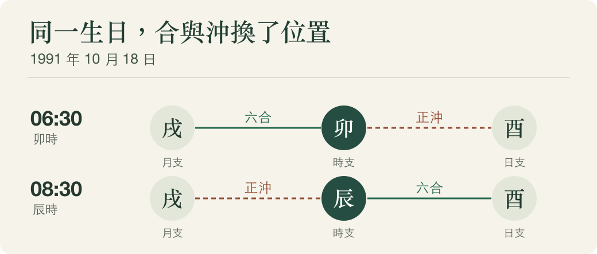

# 跟著命例學八字

[練習順逆大運，換盤核對答案](https://openfate-ai.github.io/bazi-engine/library/practice.html) · [新版試讀｜六對同日異時命例與三堂讀盤課](reader-pilot/README.md)

第一次看八字，可以從一個字學起：為什麼 1900 年元旦這張盤，四個天干都沒有辛，解讀裡卻出現了「正官」？先在四柱圖裡找到它，再換一個出生時辰，看原本的判斷還成不成立。[從第一課開始](reading-pillars.md) · [English field guide](en.md)

[讀卯時和辰時的兩份職涯成稿，看面試問題為什麼跟著改變。](career-readings.md)

## 選一個想弄懂的問題

| 問題 | 帶哪一張盤來讀 |
| --- | --- |
| [四個天干都沒有辛，正官藏在哪裡？](reading-pillars.md) | 1900 元旦的子時與丑時。先學會讀天干、地支和藏干。 |
| [同一天出生，為什麼兩篇給了一樣的加薪建議？](schools.md) | 1991 年三個時辰，對讀《子平真詮》《窮通寶鑑》與原書命式。 |
| [日主在藏干裡出現一次，能直接判身旺嗎？](roots.md) | 2000 年閏日的丁火，找出午與未中兩個分量不同的丁。 |
| [同一個時支怎會一邊合、一邊沖？](interactions.md) | 比較卯時和辰時，畫出關係究竟牽到哪一柱。 |
| [四柱相同，第一步大運為什麼差了四年？](luck-direction.md) | 同時出生的女、男兩筆排運輸入，分別數到立冬與寒露。 |
| [為什麼立春當天有一筆起運日留白？](solar-term.md) | 1932 年立春前後三個時刻，分清民用時刻、真太陽時與交節瞬間。 |
| [同樣寫著「午」，可以叫歲運並臨嗎？](annual-reading.md) | 對照 2025、2026 年中資料，把出生年支、大運和流年各自放回去。 |

每課都能在 GitHub 讀完。想知道自己是否能獨立看一張盤，末尾有三張新盤，展開才會看見解答。[讀陌生的盤](practice.md)

## 讀書、查盤、改規則

古書有時列的是一整張命式，有時只假設幾個干支來講條件。書目保留卷次、篇名與影印頁，方便回到上下文。現代案例一律採 v2.0.0 公開出生網格，固定 UTC+8、東經 120 度，並標示排運輸入。職場與關係的生活例子是 OpenFate 編寫的情境。教材沒有使用當事人自述。[原典與讀法索引](sources.md)

要查自己的年份，下載離線閱讀器及該年的排盤檔。要重查本課，直接讀欄位摘錄，或用七個年度檔重放。可查範圍為 1900-01-01 至 2026-11-22，共 1,112,328 組代表輸入、402,736 種四柱。[閱讀器](https://github.com/openfate-ai/bazi-engine/releases/download/corpus-v2.0.0/reader.html) · [資料與原創解讀下載](https://github.com/openfate-ai/bazi-engine/releases/tag/corpus-v2.0.0) · [重查教材](replay.md) · [成稿規則](https://github.com/openfate-ai/bazi-engine/tree/corpus-v2.0.0/corpus)

若某一段古文還有另一種解法，可附原書位置與反例，從該課開始討論。現在已有原典頁面與出刊資料核對；專家審讀和初學者試讀仍待進行。[核對範圍與勘誤方式](sources.md#核對與勘誤)
