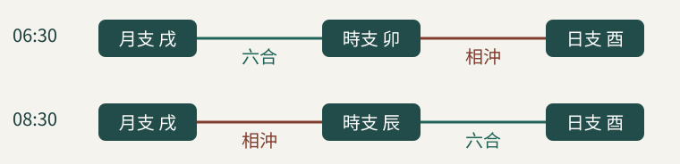
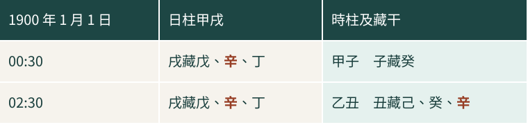
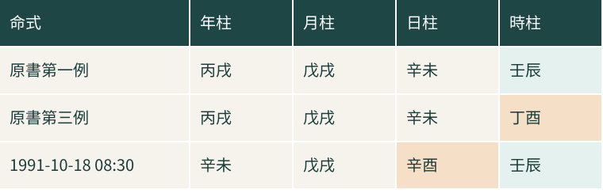

# 三堂讀盤課

每堂先看圖，再遮住答案做一題。圖中現代盤的輸入都採固定 UTC+08:00 女盤。

## 一個時支，同時牽到哪兩柱？

看 1991 年 10 月 18 日的兩張盤。把手指放在時支，分兩次往左找：先找日支，再找月支。兩次都要說出碰到的是哪個字。

卯時，沖落在日支與時支之間。換成辰時，這一對改為六合，沖卻出現在月支與時支。若只記「一合一沖」，隔天看到同樣四個字，就分不出是哪張盤。 六沖配對可按地支順序記：子午、丑未、寅申、卯酉、辰戌、巳亥。找出這兩個字之後，還要記它們出現在哪兩柱。

原書用甲生酉月、另見卯等條件討論沖合的解法。上圖是現代排盤；僅憑圖中兩條線，還不能決定何者「解」了何者。 [原典位置](<https://upload.wikimedia.org/wikipedia/commons/f/fe/NLC416-11jh010455-35296_%E5%AD%90%E5%B9%B3%E7%9C%9F%E8%A9%AE.pdf#page=23>)

隔天 08:30，四柱是辛未、戊戌、壬戌、甲辰。兩個戌遇到同一個辰。你會記一條沖，還是兩條？寫出柱位。

核對答案

月支戌沖時支辰，日支戌也沖時支辰。干支相同仍要保留兩組柱位；少一組，就少記了這張盤的一個關係。

## 甲日的正官，能在哪一格找到？

先用日干認字。《三命通會》卷五以甲見辛為正官。拿到甲日盤就找辛，再看它寫在柱的上方，還是藏在下方地支裡。

兩盤前兩柱都是己亥、丙子。看 00:30，四個天干依序是己、丙、甲、甲，沒有辛。再翻到日支戌，辛在裡面。若只讀天干，就會漏掉這一處正官。

原段說明甲日如何辨庚與辛。圖中兩個出生時刻出自現代資料；辛出現的次數，不能單獨推出官職或格局。 [原典位置](<https://zh.wikisource.org/wiki/三命通會_(四庫全書本)/卷05>)

換到 02:30。有幾處藏辛？四個天干有沒有辛？先寫出位置，再翻解答。

核對答案

辛一處在日支戌，一處在時支丑。四干是己、丙、甲、乙，都沒有辛。可記為正官藏在兩支，天干未透。

## 古例跟今盤只差一個日支，哪句還能用？

《窮通寶鑑》〈三秋辛金〉九月段末列了幾個命式。原表由時、日、月、年排列。下圖已轉成年、月、日、時；先看前兩列，再把第一列和第三列逐格對照。

古例一和今盤同為戌月、辛日、壬辰時。原段談九月辛金取壬、甲的次序，可以帶著同一個問題回去讀。看日支卻分了路：今盤日酉與時辰六合，古例一日未、時辰，這句不能搬過去。

九月依節令取戌月。選入本課的兩個古例保留刊載的干支；讀者可以直接核對命式，不必替古人補生日或經歷。 [原典位置](<https://zh.wikisource.org/zh-hant/穷通宝鉴#三秋辛金>)

只比原書第一例和第三例。哪一柱換了？如果你要查「壬有沒有透在時干」，答案會怎麼變？

核對答案

時柱從壬辰換成丁酉。第一例的時干是壬，第三例的時干是丁。兩例的年月日三柱相同，這個差異可以直接在原表核對。

